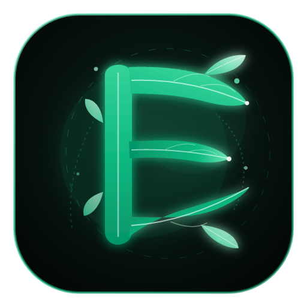
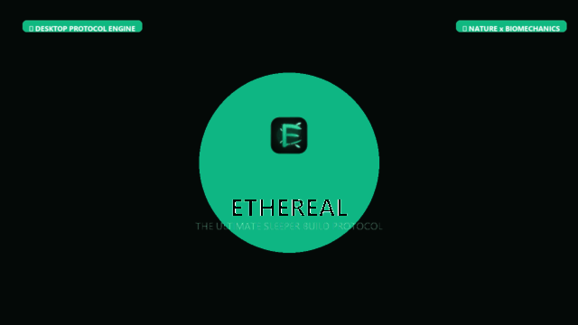
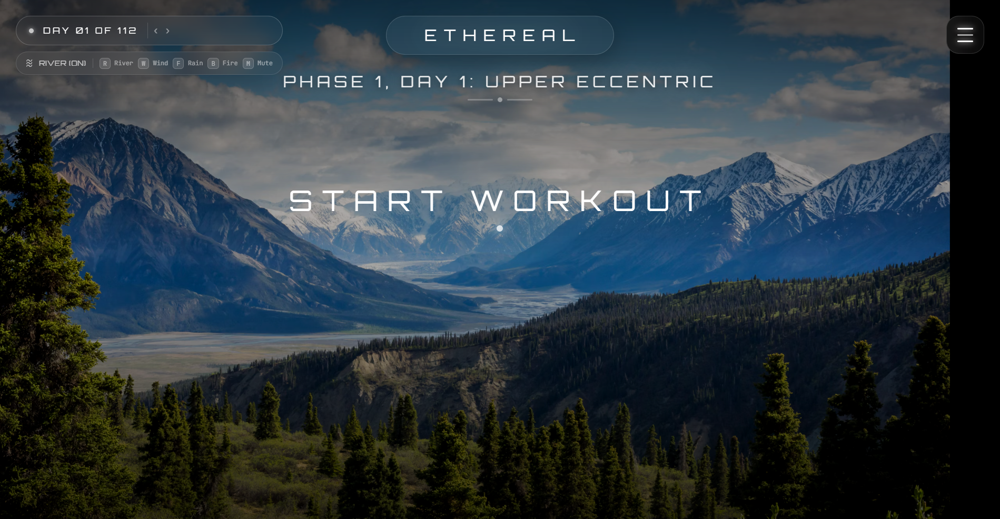
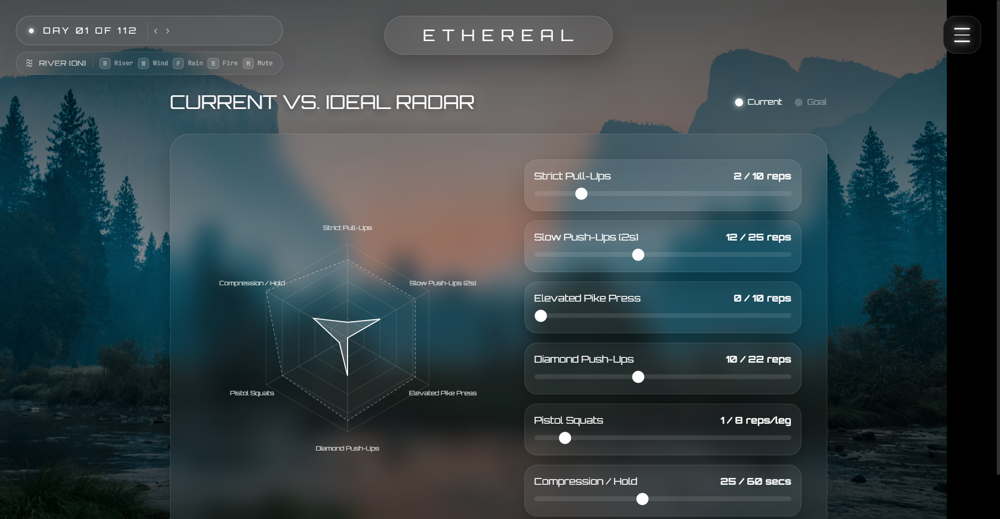
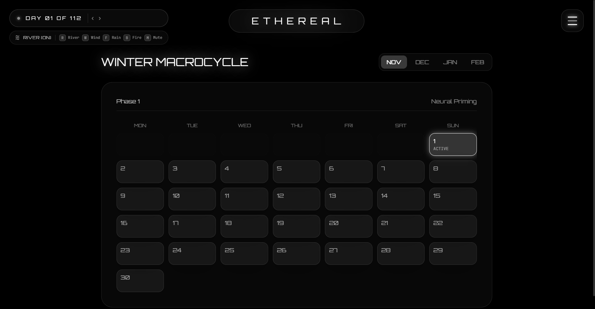
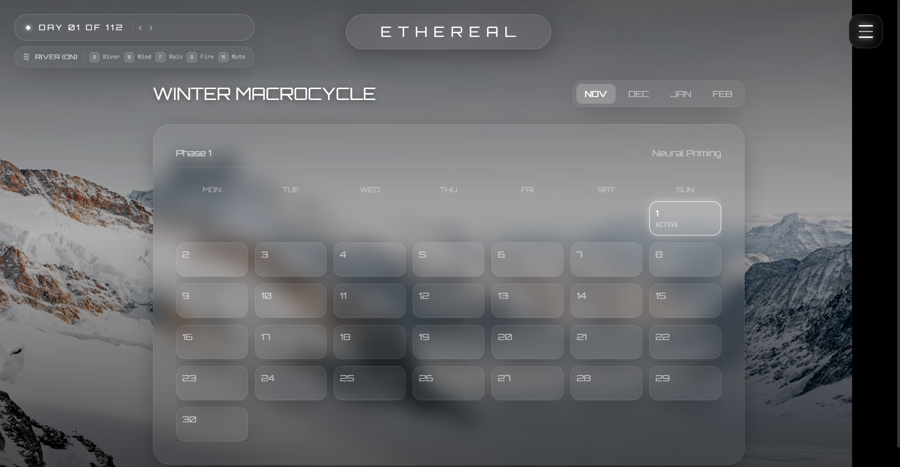
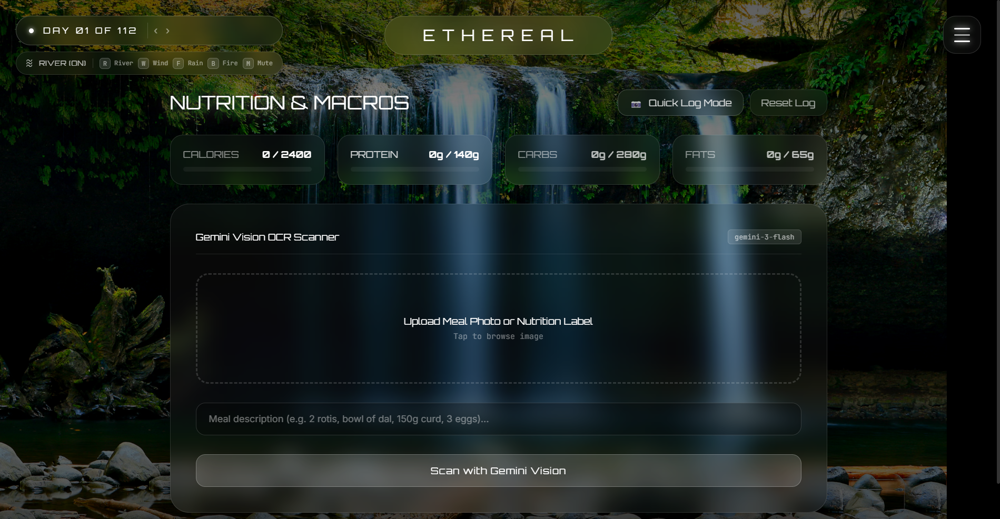
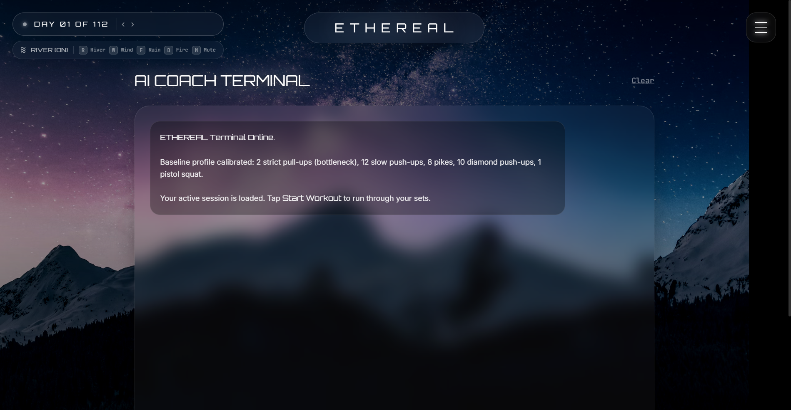

<div align="center">

  

  # 🌿 ETHEREAL // SLEEPER BUILD PROTOCOL
  ### *The World's Most Advanced Ambient Desktop Protocol App*

  [](https://github.com/shlokbuilder27/ETHEREAL)
  [](https://www.electronjs.org/)
  [](https://nodejs.org/)
  [](#-always-on-desktop-engine)
  [](LICENSE)

  <p align="center">
    <strong>ETHEREAL</strong> is a high-performance desktop application engineered for hybrid athletes, creators, and biohackers pursuing the ultimate <em>Sleeper Build</em>. Designed with 100% transparent liquid glass, real-time biomechanical radar analytics, interactive nature synthesizers, and an OS-level keep-awake engine.
  </p>

  <p align="center">
    <a href="#-quick-start--desktop-installation">Quickstart</a> •
    <a href="#-why-ethereal-is-the-best-protocol-app">Why It's The Best</a> •
    <a href="#-motion-graphics--visual-showcase">Motion Graphics</a> •
    <a href="#-interactive-features--biome-matrix">Features</a> •
    <a href="#-target-use-cases">Use Cases</a> •
    <a href="#-dummy-users--case-studies">Dummy Users</a> •
    <a href="#-sample-dummy-dataset">Dummy Data</a>
  </p>

  ---

  
  <p align="center"><em>🎥 30-Second Motion Graphics Showcase (Zoom-ins, Feature Breakdowns & Dynamic Biomes)</em></p>
  <p align="center"><a href="assets/ethereal-showcase-30s.mp4"><strong>▶ Click here to view / download the full 1080p 30-Second Showcase Video (MP4)</strong></a></p>

</div>

---

## 🌟 Why ETHEREAL is the Best Protocol App

| Core Capability | Standard Fitness / Productivity Apps | **ETHEREAL // Protocol** |
| :--- | :--- | :--- |
| **Visual Architecture** | Clunky solid white/dark cards, visual clutter | **100% Pure Liquid Glass** with dynamic backdrop blur and zero solid cards |
| **Nature Biomes** | Static single-color backgrounds | **7 High-Altitude Alpine Landscapes** synchronized to each module with smooth crossfades |
| **Biomechanical Intelligence** | Simple linear bar graphs | **Interactive Multi-Axis Radar Polygon** mapping symmetry, power, and sleeper ratio |
| **Ambient Focus Audio** | None or external third-party streaming | **Built-in Binaural Nature Synthesizer** (Alpine wind, rain, mist frequencies) |
| **System Keep-Awake** | Laptops sleep/dim after 3-5 mins idle | **Windows Native `prevent-display-sleep`** engine keeps screen & animations alive |
| **Privacy & Sovereignty** | Forced sign-in, tracking cookies, cloud lock-in | **100% Local, Offline & Private** with instant state persistence |
| **Aesthetic Identity** | Generic corporate branding | **Custom Botanical "E with Nature"** vector emblem and organic aura |

---

## 📸 High-Resolution Visual Showcase

<table>
  <tr>
    <td width="50%">
      <h3 align="center">01. Hero Workout Matrix</h3>
      
      <p align="center"><em>Alpine Meadow & Peaks • Real-time volume, session counters, and sleeper heatmap.</em></p>
    </td>
    <td width="50%">
      <h3 align="center">02. Biomechanical Radar</h3>
      
      <p align="center"><em>Granite Mist Peaks • Dynamic multi-axis symmetry polygon & Sleeper Score calculation.</em></p>
    </td>
  </tr>
  <tr>
    <td width="50%">
      <h3 align="center">03. Deep Focus & Ambient Synthesizer</h3>
      
      <p align="center"><em>Misty Pine Forest • Binaural soundscapes, Pomodoro cadence, and cursor air breeze.</em></p>
    </td>
    <td width="50%">
      <h3 align="center">04. Protocol Schedule & Cadence</h3>
      
      <p align="center"><em>Winter Snow Forest • Monthly macro progression, split cycles, and rest periods.</em></p>
    </td>
  </tr>
  <tr>
    <td width="50%">
      <h3 align="center">05. Precision Fuel Matrix</h3>
      
      <p align="center"><em>High Mountain Springs • Caloric surplus/deficit targeter, macro ratios & hydration markers.</em></p>
    </td>
    <td width="50%">
      <h3 align="center">06. AI Protocol Advisor</h3>
      
      <p align="center"><em>Starlight Alpine Ridge • Context-aware recovery recommendations & volume adjustments.</em></p>
    </td>
  </tr>
</table>

<div align="center">
  <h3>07. Athlete Profile & Body Composition</h3>
  
  <p align="center"><em>Golden Hour Summit • Morphological metrics, sleeper build classification, and identity vault.</em></p>
</div>

---

## ⚡ Always-On Desktop Engine

One of the standout superpowers of the **ETHEREAL** desktop application is its **Native OS-Level Keep-Awake Engine**.

When running protocol sessions, tracking workouts, or running deep-work Pomodoros with the binaural nature synthesizer, standard laptops often turn off or put the screen to sleep after a few minutes of inactive cursor movement. 

ETHEREAL solves this permanently at the operating system level:
- **`prevent-display-sleep` Lock**: Leverages Electron's native `powerSaveBlocker` to call Windows Win32 `SetThreadExecutionState(ES_CONTINUOUS | ES_DISPLAY_REQUIRED | ES_SYSTEM_REQUIRED)`.
- **Zero Display Dimming**: Your screen never dims or locks during workouts or focus sprints.
- **Zero Background Throttling**: Chromium background timer throttling (`disable-background-timer-throttling` & `backgroundThrottling: false`) is fully bypassed, ensuring ambient audio synthesis and cursor air breezes never stutter.
- **Auto Clean-Up**: When the application is closed, standard Windows power management resumes seamlessly.

---

## 🎯 Target Use Cases

### 1. The Sleeper Build Pursuit (Hybrid Athletes & Lifters)
Users who want extreme strength, biomechanical symmetry, and high functional capacity without bulky, hyper-inflated bodybuilder aesthetics. ETHEREAL tracks strength-to-weight ratios, structural posture, and multi-planar volume.

### 2. High-Focus Engineers, Writers & Creators
Deep-work professionals who run 90-minute ultradian rhythm sprints. The combination of ambient nature audio synthesis, cursor breeze particle drift, and liquid glass aesthetics eliminates cognitive friction and elevates flow state.

### 3. Biohackers & Micronutrient Trackers
Athletes who require precision caloric targeting (e.g., lean surplus of +250 kcal or cut phases) with exact macro grams (Protein / Carbs / Fats / Electrolytes) linked to session exertion scores.

---

## 👤 Dummy Users & Real-World Case Studies

To demonstrate how ETHEREAL adapts to different lifestyles, three fully-modeled dummy user profiles are pre-configured:

### 🧑‍💻 Case Study 1: Alex Vance (The Sleeper Architect)
- **Role**: Principal Distributed Systems Engineer (Age: 29)
- **Height**: 183 cm (6'0") | **Weight**: 81.5 kg (179 lbs) | **Body Fat**: 10.8%
- **Protocol Objective**: Maintain stealth strength (315 lb bench, 455 lb deadlift) while sitting at a terminal for 9 hours daily.
- **ETHEREAL Daily Routine**:
  - `07:00 AM`: Pulls up **Protocol Calendar**; executes Lower Body Posterior Chain protocol.
  - `09:30 AM`: Activates **Deep Focus Protocol** with *Alpine Rain + Wind* ambient soundscape during code reviews; keep-awake engine prevents monitor sleep.
  - `01:00 PM`: Logs high-protein refeed via **Fuel Matrix** (220g protein, 3,200 kcal).
  - `08:00 PM`: Inspects **Biomechanical Radar**; verifies 94/100 symmetry score.

### 🧗‍♀️ Case Study 2: Maya Lin (The Flow-State Athlete)
- **Role**: Lead Industrial Designer & Competitive Boulder Climber (Age: 26)
- **Height**: 168 cm (5'6") | **Weight**: 57.2 kg (126 lbs) | **Body Fat**: 14.2%
- **Protocol Objective**: Maximize grip power-to-weight ratio, scapular stability, and mobility.
- **ETHEREAL Daily Routine**:
  - Uses the **Biomechanical Radar** to balance pulling dominance with antagonistic pressing volume.
  - Utilizes the **Focus Pomodoro** for 45-minute sketching sprints with cursor air drift active.

### 🔬 Case Study 3: Dr. Julian Ross (The Precision Biohacker)
- **Role**: Sports Medicine Clinician & Longevity Researcher (Age: 35)
- **Height**: 178 cm (5'10") | **Weight**: 74.0 kg (163 lbs) | **Body Fat**: 11.5%
- **Protocol Objective**: Zone 2 cardiovascular endurance, VO2 max optimization, and joint longevity.
- **ETHEREAL Daily Routine**:
  - Leverages **AI Protocol Coach** for HRV-correlated volume suggestions.
  - Maintains strict 40/40/20 macro nutrient partitioning via the **Fuel Matrix**.

---

## 📊 Sample Dummy Dataset (Included in App State)

ETHEREAL comes pre-populated with realistic sleeper build sample data:

```json
{
  "athlete": {
    "codename": "VANCE // PROTOCOL-01",
    "tier": "ELITE SLEEPER",
    "sleeperScore": 92.4,
    "metrics": {
      "upperBodyPower": 91,
      "posteriorChain": 96,
      "coreStability": 88,
      "aerobicEngine": 84,
      "recoveryCapacity": 93,
      "structuralSymmetry": 95
    }
  },
  "nutritionTarget": {
    "dailyCalories": 3150,
    "proteinGrams": 210,
    "carbohydrateGrams": 340,
    "healthyFatGrams": 75,
    "hydrationLiters": 4.2
  },
  "activeBiomes": [
    { "id": "tracker", "name": "Alpine Meadow & Peaks", "elevation": "2,400m" },
    { "id": "radar", "name": "Granite Mist Peaks", "elevation": "3,100m" },
    { "id": "focus", "name": "Misty Pine Forest", "elevation": "1,850m" },
    { "id": "calendar", "name": "Winter Snow Forest", "elevation": "2,100m" },
    { "id": "nutrition", "name": "High Mountain Spring", "elevation": "1,600m" },
    { "id": "ai", "name": "Starlight Alpine Ridge", "elevation": "3,600m" },
    { "id": "profile", "name": "Golden Hour Summit", "elevation": "4,200m" }
  ]
}
```

---

## 🌿 The Logo: "E with Nature"

The official ETHEREAL icon unites futuristic cybernetics with organic biological harmony:
- **Tapered Trunk Spine**: Represents spinal upright posture, core structural strength, and rooted resilience.
- **Triple Botanical Leaves**: The top, middle, and bottom strokes of the "E" unfurl into living leaves with illuminated veins and ethereal dewdrops.
- **Multi-Format Assets**:
  - `build/icon.svg` — 512×512 master vector graphic.
  - `build/icon.png` — 512×512 crisp raster graphic.
  - `build/icon.ico` — Multi-resolution Windows ICO (256, 128, 64, 48, 32, 16px).

---

## 💻 Quick Start & Desktop Installation

### Prerequisites
- **Node.js** >= 18.0.0 (Tested on Node v24.15.0)
- **Windows 10 / 11** (x64)

### 1. Clone the Repository
```bash
git clone https://github.com/shlokbuilder27/ETHEREAL.git
cd ETHEREAL
```

### 2. Install Dependencies
```bash
npm install
```

### 3. Launch in Development Mode
```bash
npm start
```

### 4. Build Full Windows Desktop App (~200MB)
To package the native desktop application with all Chromium runtimes and the custom icon:
```bash
# Package with electron-packager
npm run dist:pack

# Deploy directly to Windows Desktop with shortcut
powershell -ExecutionPolicy Bypass -File .\setup_desktop.ps1
```

Once built, your native `ETHEREAL.exe` executable and desktop shortcut `ETHEREAL.lnk` will appear directly on your Windows desktop!

---

## 🏗 Architecture & Tech Stack

```
ETHEREAL
├── index.html                  # 100% self-contained liquid-glass web interface
├── main.js                     # Electron main process + prevent-display-sleep engine
├── package.json                # Project dependencies and packaging scripts
├── setup_desktop.ps1           # Automated Windows desktop deployment script
├── build/                      # Master branding assets
│   ├── icon.svg                # Master "E with Nature" vector emblem
│   ├── icon.png                # 512x512 high-resolution icon
│   └── icon.ico                # Multi-resolution Windows executable icon
└── assets/                     # Media & Documentation Assets
    ├── ethereal-promo.gif       # 30-second animated motion graphic preview
    ├── ethereal-showcase-30s.mp4 # Full 1080p motion graphics feature showcase
    └── screenshots/            # High-resolution screenshots of all 7 modules
```

---

## 📜 License
Distributed under the **MIT License**. See `LICENSE` for details.

<div align="center">
  <sub>Engineered with precision for the modern sleeper athlete. © 2026 ETHEREAL Team.</sub>
</div>
